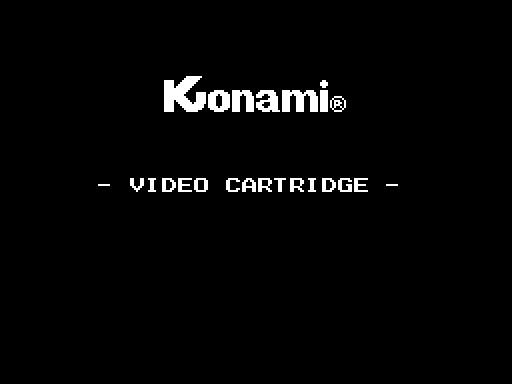
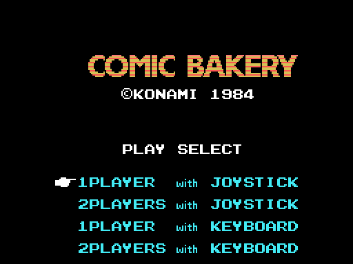

# The cartridge

16 KB in page 1 (`0x4000-0x7FFF`), an `AB` header with INIT at `0x40C7` and
no BASIC. The screen is SCREEN 2.

## VRAM

The eight registers come from `0x474F`: `02 E2 0E 7F 07 76 03 E1`. In
SCREEN 2, R3 and R4 are base and mask, so **the colour table is at `0x0000`
and the patterns at `0x2000`**.

| area | what is there |
|---|---|
| `0x0000` | the colour table |
| `0x1800` | the 64 sprite patterns |
| `0x2000` | the patterns |
| `0x3800` | the name table; the bakery, from `0x39A0` |
| `0x3B00` | the sprite attributes |

## RAM

**The game's whole RAM is 1 KB**: `0xE000-0xE3FF`, cleared by INIT. The stack
is at `0xE400`.

| area | what is there |
|---|---|
| `0xE000` / `0xE001` | the scene and the sub-state |
| `0xE003` | the frame counter |
| `0xE00B` | its low three bits: the eight-beat |
| `0xE00D` | the end-of-stage flag |
| `0xE038` | the copy of the eight VDP registers |
| `0xE050` | the player in turn, 48 bytes; the other at `0xE0C0` |
| `0xE051` | the stage counter, from zero |
| `0xE080` | the sprite buffer |
| `0xE110` | the state of the three raccoons |
| `0xE1A0` | the bakery window, 320 bytes |

## The BIOS

It uses seven routines: RDPSG, RDVDP, SETRD, SETWRT, SNSMAT, WRTPSG and
WRTVDP. It has its own for reading VRAM.

## The two menu screens

Both are drawn from the ROM and checked against openMSX down to **0 bytes**.

