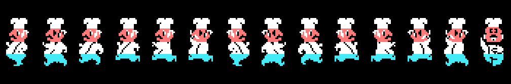
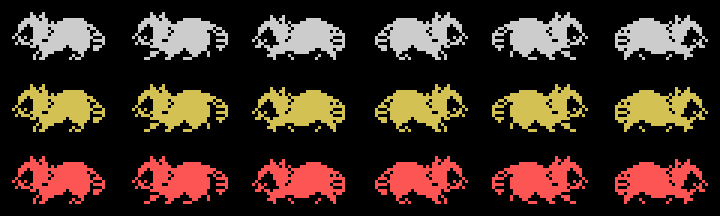
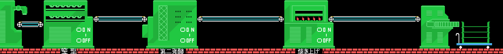
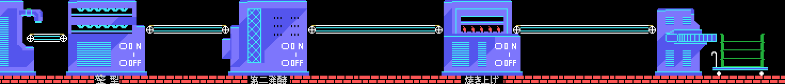
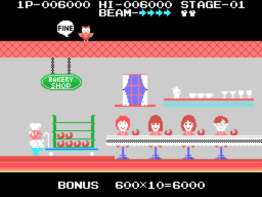
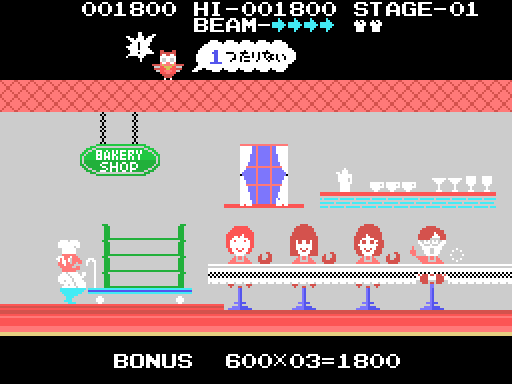
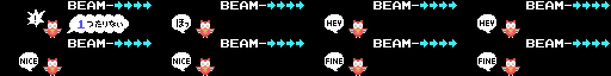

# The game

The baker guards the bakery from the **raccoons** during an **eight-minute**
working day by the clock (`0x4614`). The baker walks along the floor, jumps
with both buttons and shoots; a raccoon that touches the baker costs a life.
When the day is over, the cartridge counts the loaves (`0x5B5E`).

The pictures below **are neither captures nor the cartridge running**: they
are the ROM's tables put together the way the game does it —the screens and
the bakery with its set-up chain, the baker and the raccoons with their pose
and step tables—. Checked against openMSX in sixteen game dumps: **0 bytes
different** in the colour, pattern and sprite pattern tables.

## The baker

Four sprites (`0x4C51`), with the patterns of one of the fourteen poses at
`0x7124` and the row and colour of the template at `0x7096`: the second is
0x10 below the first, the third 8 and the fourth 0x20.

## The raccoons

Two sprites in a row (`0x51D9`), the second sixteen pixels to the right and
with the pattern four further on. Walking left the patterns start at `0x78`,
and walking right 0x3C further on; the step is picked by the frame counter and
only ever gives 0, 8 or 16. There are three, told apart by the colour at
`0x51B2`: grey, yellow and red.

## Each stage's bakery

There is one bakery: the **92 columns of ten cells** at `0x7604`. The screen
shows 32 of them, from row 13 down. But the stage set-up (`0x49BB` to
`0x49E7`) picks its graphics blocks with the counter at `0xE051`, and the
bakery changes machines:

| stages | machines |
|---|---|
| 1, 2, 4, 6, 8... | green |
| 3, 5, 7, 9... | blue |

## The shop, at the end of each working day

When the day is over, the baker leaves the floor and the **BAKERY SHOP** is
set up (`0x5AD6`), with four children sitting at the counter. The baker pushes
the cart with the loaves made to the beat of the end-of-stage tune (0x96): the
cart moves on until the score reaches the `0xD4` mark (`0x5BAA`). Then each
child gets a loaf (`0x5C6F`) and a bonus of **600 × loaves** is paid
(`0x5CCF`). On the roof a character pops up with a speech balloon that
depends on the loaves (`0x5D22`):

| loaves | balloon |
|---|---|
| 4 | ほっ ("phew") |
| 5-6 | HEY |
| 7-8 | NICE |
| 9 or more | FINE |

With fewer than four, some child goes without: the balloon says how many are
missing (`4 − loaves`; "1つたりない" is "one short") and **a life is lost**
(`0x5D0E`, scene 12); with no lives left, the game is over (`0x42A9`).
Measured: with three loaves the next stage starts with one life less (2 to
1), and with ten, with the same.

Unlike the other pictures on this page, this scene **comes from running the
cartridge**, like the music: `tools/tienda.py` cold-starts it with z80run,
gives each frame what the interrupt does (`0x406E`) and takes the VRAM through
the same checked renderer. The only things set by hand are what the player
would do: press in the menu, end the day (`0xE00D`) and how many loaves were
made (`0xE060`).

## The menu screens

Built from the ROM and checked against openMSX down to **0 bytes**.

