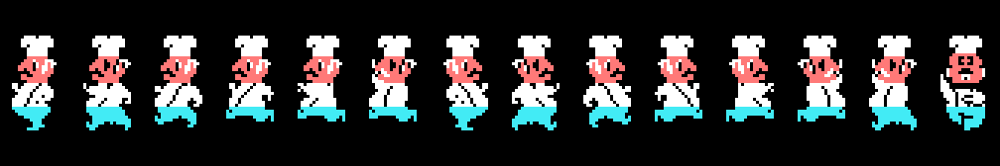
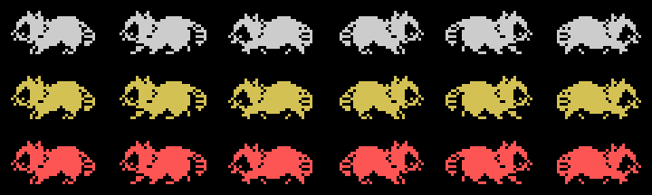
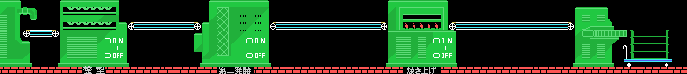
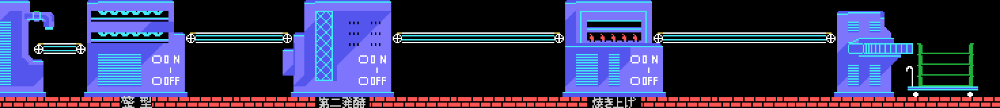
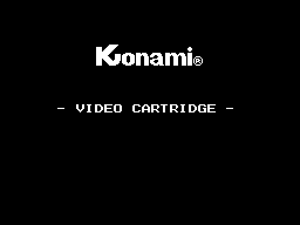
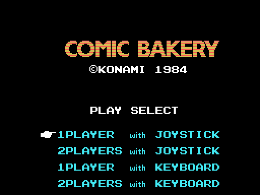
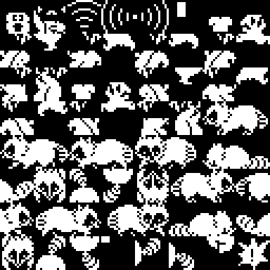
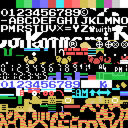

# What the cartridge draws

Under each picture is where it comes from and what is on it.

*The baker's fourteen poses: four sprites each, from the tables at 0x7124 and 0x7096.*

*The three raccoons, in their three steps each way (0x51D9).*

*The bakery on stages 1, 2, 4, 6...: the 92 columns at 0x7604.*

*The one on stages 3, 5, 7...: the same map with the other blocks.*

*The company screen, built from the ROM and checked down to 0 bytes.*

*The title screen, built the same way and checked down to 0 bytes.*

*The 64 sprite patterns, as 0x70D6 leaves them.*

*The patterns of the screen's first third.*
