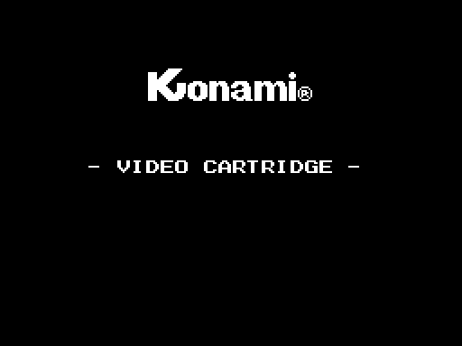
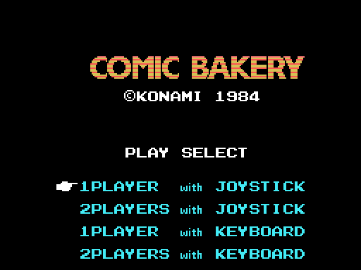

# Under the hood

## Getting started

This repository holds the commented disassembly of Konami's **Comic Bakery**
for the MSX (RC-714, 1984). It does not hold the cartridge: the ROM image is
not distributed.

### What you need

- `pasmo` — the assembler that reproduces the ROM
- `python3` — the tools in `tools/`
- `make`
- Your own copy of the cartridge, in the root and named `comicbakery.rom`

It is **exactly 16,384 bytes** and its fingerprint is:

    sha256  089e6cd7ff074c5c162325b3ac00e36e5787034bffe349b6e33db51a2e591ed8

To check it:

    make comprueba

### Reproducing all of it

| command | what it does | what it proves |
|---|---|---|
| `make listado` | traces the flow and generates `src/comicbakery.asm` with the notes | that the listing comes from the cartridge and `src/comicbakery.notes`, not hand-edited |
| `make verify` | reassembles with `pasmo` and compares | that the listing IS the ROM, byte for byte |
| `make sanity` | splits the 16,384 bytes into code and data | that not one byte is left unassigned |
| `make test` | 33 tests | that the numbers on this site are the listing's |
| `make imagenes` | draws everything in `docs/imagenes/` from the ROM | that the formats are read right |
| `make coteja_partida` | compares with sixteen openMSX dumps | zero bytes different in the tables |

The check needs the dumps first: `tools/omsx_partida.tcl`, with the stage
counter in `work/fase.txt`. See [In the emulator](UNDER-THE-HOOD.html).

## The cartridge

16 KB in page 1 (`0x4000-0x7FFF`), an `AB` header with INIT at `0x40C7` and
no BASIC. The screen is SCREEN 2.

### VRAM

The eight registers come from `0x474F`: `02 E2 0E 7F 07 76 03 E1`. In
SCREEN 2, R3 and R4 are base and mask, so **the colour table is at `0x0000`
and the patterns at `0x2000`**.

| area | what is there |
|---|---|
| `0x0000` | the colour table |
| `0x1800` | the 64 sprite patterns |
| `0x2000` | the patterns |
| `0x3800` | the name table; the bakery, from `0x39A0` |
| `0x3B00` | the sprite attributes |

### RAM

**The game's whole RAM is 1 KB**: `0xE000-0xE3FF`, cleared by INIT. The stack
is at `0xE400`.

| area | what is there |
|---|---|
| `0xE000` / `0xE001` | the scene and the sub-state |
| `0xE003` | the frame counter |
| `0xE00B` | its low three bits: the eight-beat |
| `0xE00D` | the end-of-stage flag |
| `0xE038` | the copy of the eight VDP registers |
| `0xE050` | the player in turn, 48 bytes; the other at `0xE0C0` |
| `0xE051` | the stage counter, from zero |
| `0xE080` | the sprite buffer |
| `0xE110` | the state of the three raccoons |
| `0xE1A0` | the bakery window, 320 bytes |

### The BIOS

It uses seven routines: RDPSG, RDVDP, SETRD, SETWRT, SNSMAT, WRTPSG and
WRTVDP. It has its own for reading VRAM.

### The two menu screens

Both are drawn from the ROM and checked against openMSX down to **0 bytes**.

## The code

### Everything in the interrupt

INIT (`0x40C7`) sets interrupt mode 1, hooks H.KEYI, puts the stack at
`0xE400`, clears the kilobyte of RAM and waits. The hook (`0x405C`) saves the
twelve registers, both sets with IX and IY, before doing anything. The sixteen
scenes are in the table at `0x4119`, stuck right behind the `call` of the
dispatcher at `0x4096`.

The game frame (`0x48CE`) is twenty-seven calls in a row, one for each thing
that moves or is drawn, and the clock at the end.

### The bakery

- `0x4D0C` draws a column: the index times ten, without multiplying, and ten
  indices from the map at `0x7604`, one per row.
- The 32-column window lives in the buffer at `0xE1A0` and goes to the name
  table from `0x39A0`, row 13.
- `0x49A6` sets up the stage and `0x49BB..0x49E7` pick its blocks with
  `(0xE051)`. The screen at `0x6051` is set up only once, at power-on, with the
  stage at zero.

### The figures

- `0x70D6` loads the sprite patterns: three compressed blocks and their mirror
  images (`0x443F`, which reverses each byte and swaps the two halves).
- `0x4C51` sets the baker's pose and `0x4C67` the jump, with the arc at
  `0x4CC3`.
- `0x5117` runs the three raccoons, with their ten states in the table at
  `0x5138`; `0x51D9` makes them walk.

### The rest

- The working-day clock, `0x4614`.
- The demo: `0x4775` swaps the controller reading for the 80 bytes at
  `0x6001` while in the menu.
- Randomness: the R register, at `0x498E`.

### The tools

- `tools/graficos.py`: the scene and game VRAM, the bakery and the menu
  screens.
- `tools/figuras.py`: the baker and the raccoons.
- `tools/coteja_partida.py` and `tools/omsx_partida.tcl`: the check against
  openMSX.

## In the emulator

With openMSX and the `Philips_VG_8020` machine:

    echo 2 > work/fase.txt
    openmsx -machine Philips_VG_8020 -cart comicbakery.rom -script tools/omsx_partida.tcl

`tools/omsx_partida.tcl`:

- presses space in the menu and, when scene 5 sets the stage counter to zero
  (`0x4193`), writes the one in `work/fase.txt` into `0xE051`, before the stage
  is set up;
- counts game frames with a breakpoint at `0x48CE` and dumps RAM and VRAM on
  frames 1, 50, 200, 400, 800, 1200, 1600 and 2400, into `work/partida/`.

The demo goes through `0x48CE` too, so the first dumps are of the demo, with
the counter at 1.

A warning: if a breakpoint's command fails, openMSX freezes the emulation. The
script wraps its commands in `catch` and logs the error in
`work/partida/log.txt`.

## Code shared with other Konami cartridges

This disassembly has been compared, instruction by instruction, with
every other Konami one in the series. A block counts when the same
instructions, at least six of them from a label to its `ret` or its
unconditional jump, are in both cartridges; the addresses are left
aside, because they change from one cartridge to the next. Of the
other 57, **49** have at least one block in common with this one;
these are the ones that share the most:

| Cartridge | Blocks | Instructions | For example (here = there) |
|---|---:|---:|---|
| [Circus Charlie](https://antxiko.github.io/CircusCharlie-disassembly/) | 27 | 392 | `atiende_el_menu` (0x4831) |
| [Magical Tree](https://antxiko.github.io/MagicalTree-disassembly/) | 21 | 351 | `atiende_el_menu` (0x4831) |
| [Cabbage Patch Kids](https://antxiko.github.io/CabbagePatchKids-disassembly/) | 20 | 206 | `lee_el_teclado` (0x47E8) = `LEE_EL_TECLADO` |
| [Konami’s Mahjong Dojo](https://antxiko.github.io/KonamisMahjongDojo-disassembly/) | 14 | 141 | `arranca_la_voz` (0x79E2) = `carga_los_canales` |
| [Hyper Sports 1](https://antxiko.github.io/HyperSports1-disassembly/) | 12 | 174 | `atiende_el_menu` (0x4831) = `MANEJADOR_DEMO` |
| [Yie Ar Kung-Fu](https://antxiko.github.io/YieArKungFu-disassembly/) | 12 | 125 | `lee_el_teclado` (0x47E8) |
| [Konami’s Game Master 2](https://antxiko.github.io/GameMaster2-disassembly/) | 9 | 78 | `refleja_una_franja` (0x443F) = `espejo_16` |
| [Super Cobra](https://antxiko.github.io/SuperCobra-disassembly/) | 8 | 97 | `parpadea_el_turno` (0x46A3) = `PARPADEA_EL_JUGADOR` |
| [Sky Jaguar](https://antxiko.github.io/SkyJaguar-disassembly/) | 7 | 85 | `lee_el_teclado` (0x47E8) = `LEE_TECLADO` |
| [Hyper Rally](https://antxiko.github.io/HyperRally-disassembly/) | 6 | 52 | `mira_si_es_record` (0x4599) = `ACTUALIZA_TOPE` |

The whole matrix, the 58 cartridges against each other, is on
[The routines](https://antxiko.github.io/MSX-disassembly-database/THE-ROUTINES.html) in the series database, along
with the method and the program that measures it.
