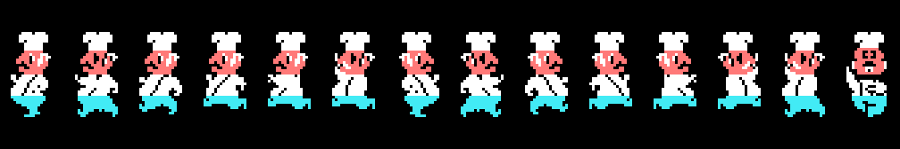
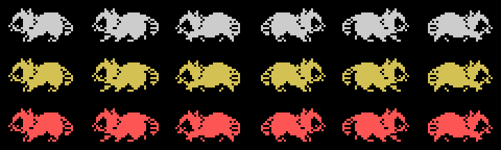
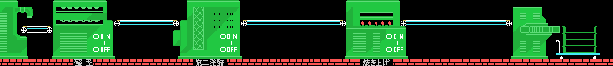
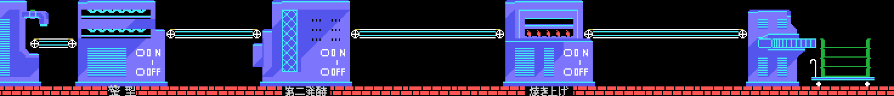
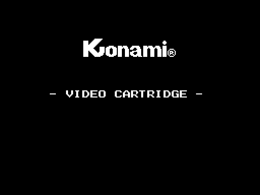
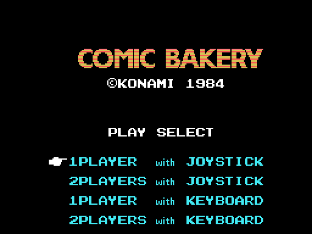
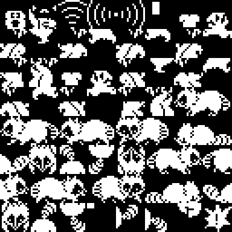
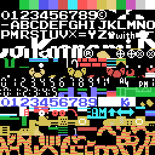

# Lo que el cartucho dibuja

Debajo de cada imagen esta de donde sale y que se esta viendo.

*El panadero en sus catorce poses: cuatro sprites cada una, desde las tablas de 0x7124 y 0x7096.*

*Los tres mapaches, en sus tres pasos hacia cada lado (0x51D9).*

*La panaderia de las fases 1, 2, 4, 6...: las 92 columnas de 0x7604.*

*La de las fases 3, 5, 7...: el mismo mapa con los otros bloques.*

*La pantalla de la casa, montada desde la ROM y cotejada a 0 bytes.*

*La de titulo, montada igual y cotejada a 0 bytes.*

*Los 64 patrones de sprite, como los deja 0x70D6.*

*Los patrones del primer tercio de la pantalla.*
