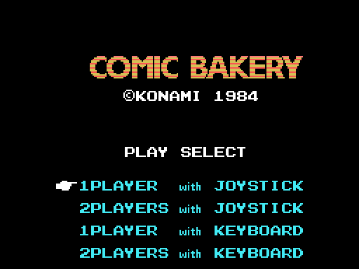

# Por dentro

## Empezar

Este repositorio contiene el desensamblado comentado de **Comic Bakery** de
Konami para MSX (RC-714, 1984). No contiene el cartucho: la imagen de la ROM no
se distribuye.

### Lo que hace falta

- `pasmo` — el ensamblador que reproduce la ROM
- `python3` — las herramientas de `tools/`
- `make`
- Tu propia copia del cartucho, en la raíz y con el nombre `comicbakery.rom`

Son **16.384 bytes exactos** y su huella es:

    sha256  089e6cd7ff074c5c162325b3ac00e36e5787034bffe349b6e33db51a2e591ed8

Para comprobarla:

    make comprueba

### Reproducirlo entero

| orden | qué hace | qué demuestra |
|---|---|---|
| `make listado` | traza el flujo y genera `src/comicbakery.asm` con las notas | que el listado sale del cartucho y de `src/comicbakery.notes`, no se edita a mano |
| `make verify` | reensambla con `pasmo` y compara | que el listado ES la ROM, byte a byte |
| `make sanity` | reparte los 16.384 bytes entre código y datos | que no queda ni un byte sin asignar |
| `make test` | 33 tests | que las cifras de esta web son las del listado |
| `make imagenes` | dibuja todo lo de `docs/imagenes/` desde la ROM | que los formatos están bien leídos |
| `make coteja_partida` | compara con dieciséis volcados de openMSX | cero bytes de diferencia en las tablas |

El cotejo necesita antes los volcados: `tools/omsx_partida.tcl`, con el
contador de fase en `work/fase.txt`. Ver [En el emulador](POR-DENTRO.html).

## El cartucho

16 KB en la página 1 (`0x4000-0x7FFF`), cabecera `AB` con INIT en `0x40C7` y
sin BASIC. Pantalla en SCREEN 2.

### La VRAM

Los ocho registros salen de `0x474F`: `02 E2 0E 7F 07 76 03 E1`. En SCREEN 2,
R3 y R4 son base y máscara, así que **el color va en `0x0000` y los patrones en
`0x2000`**.

| zona | qué hay |
|---|---|
| `0x0000` | la tabla de color |
| `0x1800` | los 64 patrones de sprite |
| `0x2000` | los patrones |
| `0x3800` | la tabla de nombres; la panadería, desde `0x39A0` |
| `0x3B00` | los atributos de los sprites |

### La RAM

**Toda la RAM del juego es 1 KB**: `0xE000-0xE3FF`, puesta a cero por INIT. La
pila, en `0xE400`.

| zona | qué hay |
|---|---|
| `0xE000` / `0xE001` | la escena y el sub-estado |
| `0xE003` | el contador de cuadros |
| `0xE00B` | sus tres bits de abajo: el compás de ocho |
| `0xE00D` | la señal de fin de fase |
| `0xE038` | la copia de los ocho registros del VDP |
| `0xE050` | el jugador en turno, 48 bytes; el otro, en `0xE0C0` |
| `0xE051` | el contador de fase, desde cero |
| `0xE080` | el búfer de los sprites |
| `0xE110` | el estado de los tres mapaches |
| `0xE1A0` | la ventana de la panadería, 320 bytes |

### La BIOS

Usa siete rutinas: RDPSG, RDVDP, SETRD, SETWRT, SNSMAT, WRTPSG y WRTVDP. Para
leer la VRAM tiene la suya.

### Las dos pantallas de menú

Están dibujadas desde la ROM y cotejadas contra openMSX a **0 bytes**.

## El código

### Todo en la interrupción

INIT (`0x40C7`) pone el modo 1 de interrupción, engancha H.KEYI, deja la pila
en `0xE400`, pone a cero el kilobyte de RAM y se queda esperando. El gancho
(`0x405C`) guarda los doce registros, los dos juegos con IX e IY, antes de hacer
nada. Las dieciséis escenas están en la tabla de `0x4119`, pegada detrás del
`call` del despachador de `0x4096`.

El cuadro de la partida (`0x48CE`) son veintisiete llamadas seguidas, una por
cada cosa que se mueve o se pinta, y el reloj al final.

### La panadería

- `0x4D0C` pinta una columna: el índice por diez, sin multiplicar, y diez
  índices del mapa de `0x7604`, uno por fila.
- La ventana de 32 columnas vive en el búfer de `0xE1A0` y va a la tabla de
  nombres desde `0x39A0`, la fila 13.
- `0x49A6` monta la fase y `0x49BB..0x49E7` eligen sus bloques con
  `(0xE051)`. La pantalla de `0x6051` se monta una sola vez, al encender, con
  la fase a cero.

### Las figuras

- `0x70D6` carga los patrones de sprite: tres bloques comprimidos y sus
  reflejos (`0x443F`, que da la vuelta a cada byte y cambia las dos mitades).
- `0x4C51` pone la pose del panadero y `0x4C67` el salto, con el arco de
  `0x4CC3`.
- `0x5117` atiende a los tres mapaches, con sus diez estados en la tabla de
  `0x5138`; `0x51D9` los hace andar.

### El resto

- El reloj de la jornada, `0x4614`.
- La demostración: `0x4775` cambia la lectura del mando por los 80 bytes de
  `0x6001` mientras se está en el menú.
- El azar: el registro R, en `0x498E`.

### Las herramientas

- `tools/graficos.py`: la VRAM de la escena y de la partida, la panadería y
  las pantallas de menú.
- `tools/figuras.py`: el panadero y los mapaches.
- `tools/coteja_partida.py` y `tools/omsx_partida.tcl`: el cotejo contra
  openMSX.

## En el emulador

Con openMSX y la máquina `Philips_VG_8020`:

    echo 2 > work/fase.txt
    openmsx -machine Philips_VG_8020 -cart comicbakery.rom -script tools/omsx_partida.tcl

`tools/omsx_partida.tcl`:

- pulsa espacio en el menú y, cuando la escena 5 pone el contador de fase a
  cero (`0x4193`), escribe en `0xE051` el de `work/fase.txt`, antes de que se
  monte la fase;
- cuenta los cuadros de partida con un punto de ruptura en `0x48CE` y vuelca
  RAM y VRAM en los cuadros 1, 50, 200, 400, 800, 1200, 1600 y 2400, en
  `work/partida/`.

La demostración también pasa por `0x48CE`, así que los primeros volcados son
de ella, con el contador a 1.

Un aviso: si la orden de un punto de ruptura falla, openMSX congela la
emulación. El guion envuelve las suyas en `catch` y apunta el error en
`work/partida/log.txt`.

## Código compartido con otros cartuchos de Konami

Este desensamblado se ha comparado, instrucción por instrucción, con
todos los demás de Konami de la serie. Cuenta un bloque cuando las
mismas instrucciones, al menos seis desde una etiqueta hasta su `ret`
o su salto sin condición, están en los dos cartuchos; las direcciones
no se miran, porque cambian de un cartucho a otro. De los otros 57,
**49** tienen al menos un bloque en común con este; estos son los
que más comparten:

| Cartucho | Bloques | Instrucciones | Por ejemplo (aquí = allí) |
|---|---:|---:|---|
| [Circus Charlie](https://antxiko.github.io/CircusCharlie-disassembly/es/) | 27 | 392 | `atiende_el_menu` (0x4831) |
| [Magical Tree](https://antxiko.github.io/MagicalTree-disassembly/es/) | 21 | 351 | `atiende_el_menu` (0x4831) |
| [Cabbage Patch Kids](https://antxiko.github.io/CabbagePatchKids-disassembly/es/) | 20 | 206 | `lee_el_teclado` (0x47E8) = `LEE_EL_TECLADO` |
| [Konami’s Mahjong Dojo](https://antxiko.github.io/KonamisMahjongDojo-disassembly/es/) | 14 | 141 | `arranca_la_voz` (0x79E2) = `carga_los_canales` |
| [Hyper Sports 1](https://antxiko.github.io/HyperSports1-disassembly/es/) | 12 | 174 | `atiende_el_menu` (0x4831) = `MANEJADOR_DEMO` |
| [Yie Ar Kung-Fu](https://antxiko.github.io/YieArKungFu-disassembly/es/) | 12 | 125 | `lee_el_teclado` (0x47E8) |
| [Konami’s Game Master 2](https://antxiko.github.io/GameMaster2-disassembly/es/) | 9 | 78 | `refleja_una_franja` (0x443F) = `espejo_16` |
| [Super Cobra](https://antxiko.github.io/SuperCobra-disassembly/es/) | 8 | 97 | `parpadea_el_turno` (0x46A3) = `PARPADEA_EL_JUGADOR` |
| [Sky Jaguar](https://antxiko.github.io/SkyJaguar-disassembly/es/) | 7 | 85 | `lee_el_teclado` (0x47E8) = `LEE_TECLADO` |
| [Hyper Rally](https://antxiko.github.io/HyperRally-disassembly/es/) | 6 | 52 | `mira_si_es_record` (0x4599) = `ACTUALIZA_TOPE` |

La matriz entera, los 58 cartuchos entre sí, está en
[Las rutinas](https://antxiko.github.io/MSX-disassembly-database/es/LAS-RUTINAS.html) de la base de datos de la
serie, con el método y el programa que la mide.
